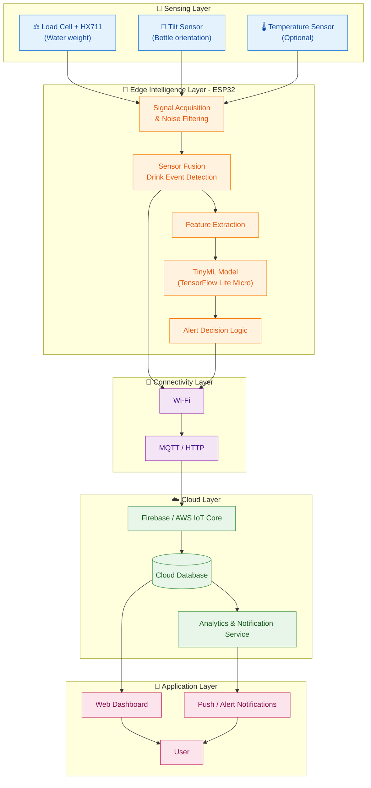
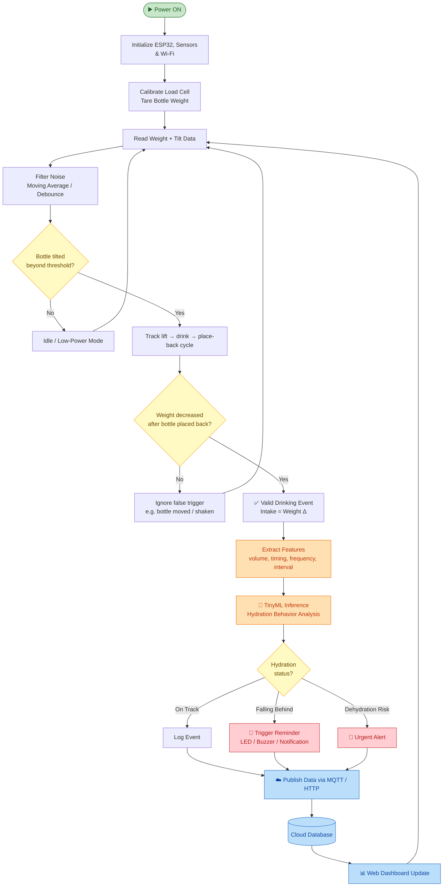
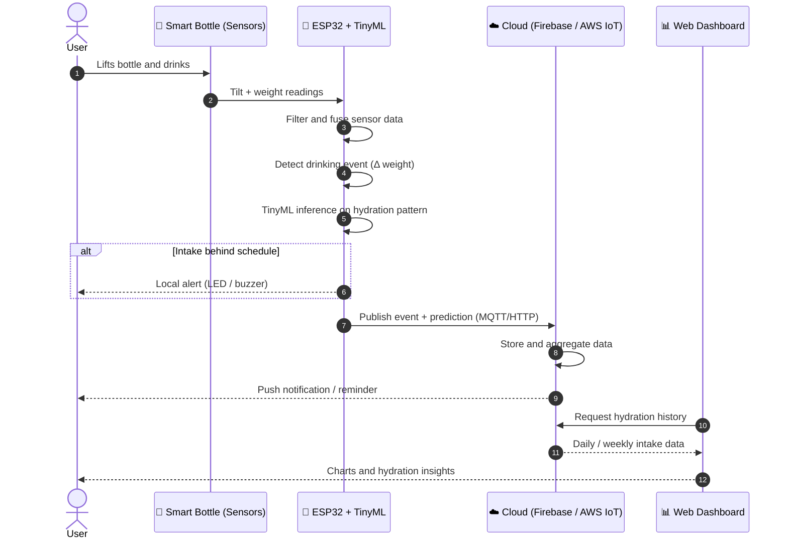
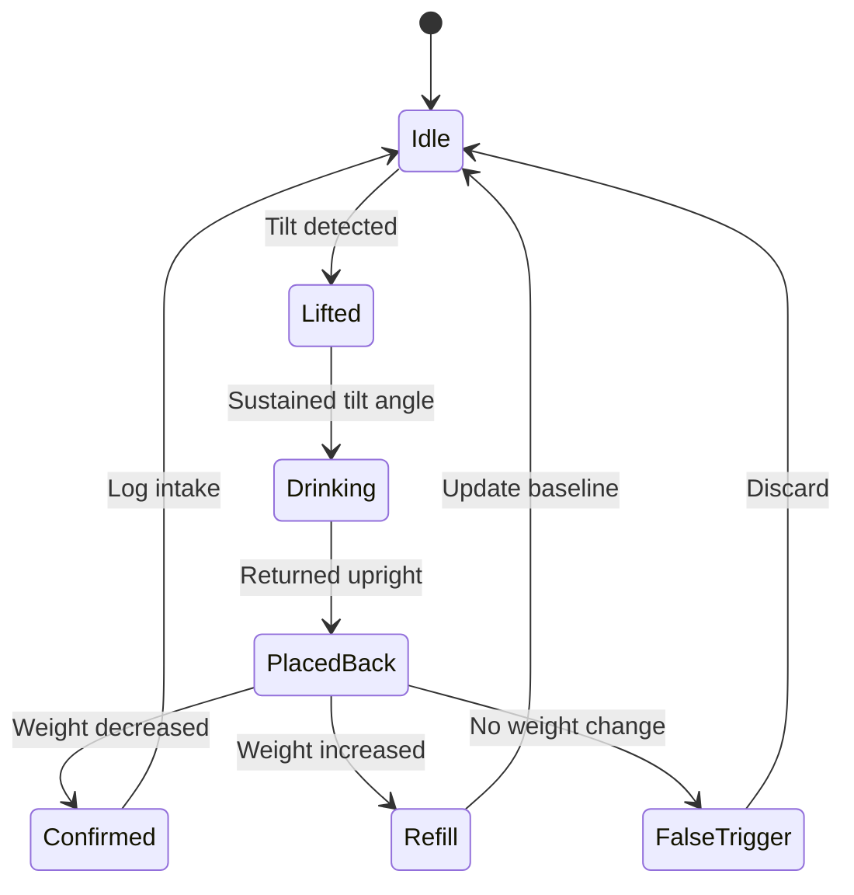
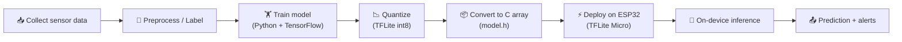

<div align="center">

# 💧 AI-Powered Smart Hydration Tracker using IoT and TinyML

**A cloud-connected, on-device-intelligent smart bottle system that detects drinking events using sensor fusion and helps prevent dehydration.**


</div>

---

## 📑 Table of Contents

- [Overview](#-overview)
- [Features](#-features)
- [System Architecture](#-system-architecture)
- [Workflow Diagram](#-workflow-diagram)
- [Data Flow Sequence](#-data-flow-sequence)
- [Sensor Fusion Logic](#-sensor-fusion-logic)
- [TinyML Pipeline](#-tinyml-pipeline)
- [Tech Stack](#-tech-stack)
- [Hardware Requirements](#-hardware-requirements)
- [Project Structure](#-project-structure)
- [Getting Started](#-getting-started)
- [Screenshots](#-screenshots)
- [Future Enhancements](#-future-enhancements)
- [Author](#-author)

---

## 📖 Overview

Dehydration often goes unnoticed in daily life. This project presents a **cloud-based intelligent hydration system** that:

- Detects **drinking events** by fusing data from a **load cell** and a **tilt sensor**
- Runs **TinyML inference on the ESP32** to analyze user hydration behavior at the edge
- Syncs data to the **cloud** in real time for storage and visualization
- Sends **proactive alerts** when the user is falling behind on hydration goals

---

## ✨ Features

| Feature | Description |
|---|---|
| 💧 Real-time intake monitoring | Continuously tracks water level and consumption |
| 🎯 Sensor-fusion detection | Combines weight and tilt data to confirm genuine drinking events |
| 🧠 TinyML analytics | On-device behavior analysis with low latency and no constant cloud dependency |
| 🔔 Intelligent alerts | Reminders triggered when intake falls behind the expected pattern |
| ☁️ Cloud sync | Stores and synchronizes hydration data via Firebase / AWS IoT |
| 📊 Web dashboard | Visualizes daily and weekly hydration trends |
| 🔋 Low-power design | Battery-powered ESP32 with sleep modes |

---

## 🏗️ System Architecture

The system follows a layered IoT architecture: **Sensing → Edge Intelligence → Connectivity → Cloud → Application**.



### Layer Summary

| Layer | Components | Responsibility |
|---|---|---|
| **Sensing** | Load cell, HX711, tilt sensor, temperature sensor | Capture raw physical signals |
| **Edge Intelligence** | ESP32 + TensorFlow Lite Micro | Filter, fuse, classify, and decide locally |
| **Connectivity** | Wi-Fi, MQTT / HTTP | Reliable transmission to the cloud |
| **Cloud** | Firebase / AWS IoT | Storage, analytics, notifications |
| **Application** | Web dashboard, alerts | Visualization and user feedback |

---

## 🔄 Workflow Diagram

End-to-end operation of the hydration tracker, from sensing to alerting:



---

## 🔁 Data Flow Sequence



---

## 🎯 Sensor Fusion Logic

Neither sensor alone is reliable. Fusing both reduces false detections:

| Load Cell (Weight) | Tilt Sensor | Interpretation |
|---|---|---|
| Stable | Upright | Idle |
| Fluctuating | Tilted | Bottle being lifted or drinking in progress |
| Decreased after settling | Upright again | ✅ **Confirmed drinking event** |
| Unchanged after settling | Upright again | ❌ False trigger (moved or shaken) |
| Increased after settling | Upright again | 🔄 Bottle refill |



---

## 🧠 TinyML Pipeline



**Why TinyML?**
- ⚡ Low latency: decisions are made on the device
- 🔋 Lower power use, since less data is transmitted
- 🔒 Better privacy: raw sensor data stays local
- 📶 Works even when the network is temporarily unavailable

---

## 🛠️ Tech Stack

### Hardware
- ESP32 Microcontroller
- Load Cell Sensor + HX711 Amplifier
- Tilt Sensor
- Temperature Sensor (Optional)
- Li-ion Battery Module

### Software & Tools
- Arduino IDE
- TinyML / TensorFlow Lite
- Firebase / AWS IoT
- Python
- MQTT / HTTP Protocols
- Git & GitHub

---

## 🔧 Hardware Requirements

| Component | Purpose |
|---|---|
| ESP32 Dev Board | Main controller with Wi-Fi and edge inference |
| Load Cell + HX711 | Measures water weight accurately |
| Tilt Sensor | Detects bottle orientation |
| Temperature Sensor *(optional)* | Adjusts hydration targets for ambient conditions |
| Li-ion Battery + Charger Module | Portable power supply |

### Suggested Pin Connections *(adjust to your wiring)*

| Module | Pin | ESP32 GPIO |
|---|---|---|
| HX711 | DT | GPIO 16 |
| HX711 | SCK | GPIO 4 |
| Tilt Sensor | OUT | GPIO 17 |
| Temp Sensor | DATA | GPIO 5 |

---

## 📂 Project Structure

```
AI-POWERED-SMARTHYDRATION-TRACKER-USING-IOT-AND-TINY-ML/
│
├── Smart-Hydration-Tracker/     # Source code, firmware, and project files
├── images/                      # Screenshots and diagrams (add here)
└── README.md                    # Project documentation
```

---

## 🚀 Getting Started

### 1. Clone the repository
```bash
git clone https://github.com/DharaniSiva78/AI-POWERED-SMARTHYDRATION-TRACKER-USING-IOT-AND-TINY-ML.git
cd AI-POWERED-SMARTHYDRATION-TRACKER-USING-IOT-AND-TINY-ML/Smart-Hydration-Tracker
```

### 2. Set up the Arduino IDE
- Install the **ESP32 board package**
- Install required libraries: `HX711`, `WiFi`, `PubSubClient` (MQTT), and a TensorFlow Lite Micro library for ESP32

### 3. Configure credentials
Update Wi-Fi and cloud settings in the firmware:
```cpp
const char* ssid     = "YOUR_WIFI_SSID";
const char* password = "YOUR_WIFI_PASSWORD";
// Add your Firebase / AWS IoT configuration here
```

### 4. Calibrate the load cell
Place a known weight on the sensor and adjust the calibration factor until the reading is accurate.

### 5. Upload and run
Select your ESP32 board and port, upload the sketch, then open the Serial Monitor at `115200` baud.

---

## 🖼️ Screenshots


## 🔮 Future Enhancements

- 📱 Mobile app (Android / iOS) with push notifications
- 🧑‍⚕️ Personalized hydration goals based on age, weight, and activity
- 🌦️ Weather-aware hydration recommendations
- ⌚ Wearable and smartwatch integration
- 🗣️ Voice assistant integration
- 🔋 Further power optimization with deep-sleep scheduling
- 📈 Federated learning for privacy-preserving model improvement

---

## 👤 Author

**Dharani Siva**
GitHub: [@DharaniSiva78](https://github.com/DharaniSiva78)

---

<div align="center">

⭐ If you found this project useful, please consider giving it a star!

</div>
